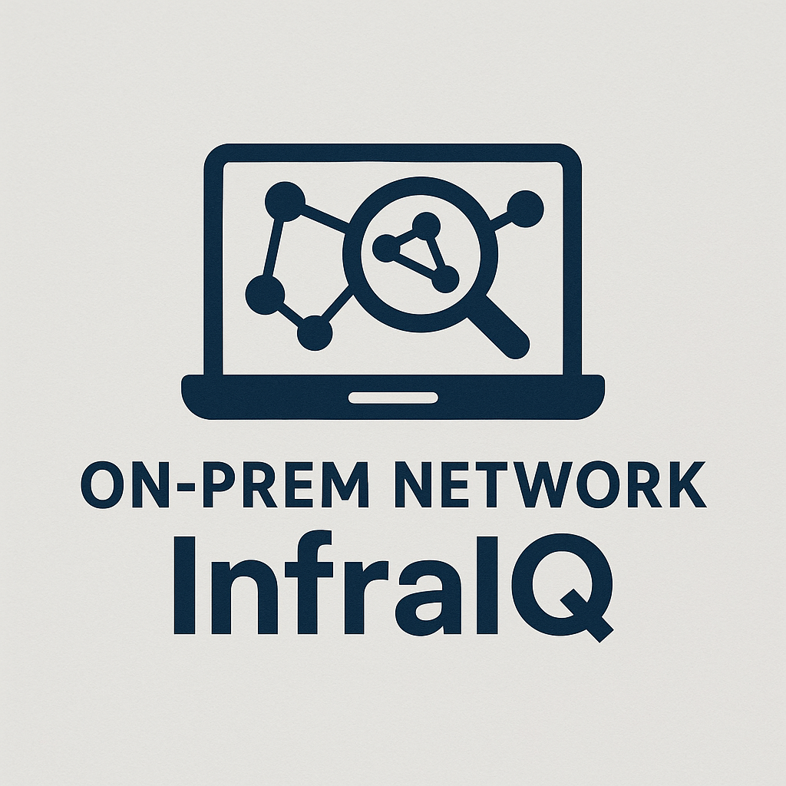
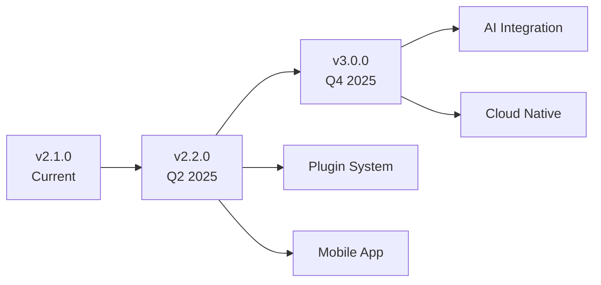

<div align="center">



# 🔍 On-Prem Network InfraIQ

### Enterprise Network Intelligence at Your Fingertips

[](https://dotnet.microsoft.com/download)
[](https://opensource.org/licenses/MIT)
[](https://github.com/jomardyan/On-Prem-Network-InfraIQ/releases)
[](https://github.com/jomardyan/On-Prem-Network-InfraIQ)

[](https://github.com/jomardyan/On-Prem-Network-InfraIQ)
[](https://hub.docker.com)
[](https://swagger.io)
[](https://github.com/jomardyan/On-Prem-Network-InfraIQ)

<p align="center">
  <strong>Enterprise-grade network discovery and security assessment platform built with C# and .NET 8.0</strong>
</p>

<p align="center">
  <a href="#-features">Features</a> •
  <a href="#-quick-start">Quick Start</a> •
  <a href="#-documentation">Documentation</a> •
  <a href="#-demo">Demo</a> •
  <a href="#-contributing">Contributing</a>
</p>

---


</div>

## 🎯 Overview

On-Prem Network InfraIQ is a powerful, cross-platform network scanning and security assessment tool designed for cybersecurity professionals, network administrators, and penetration testers. Built with modern C# and .NET 8.0, it provides comprehensive network infrastructure intelligence capabilities with both console and web-based interfaces.

<div align="center">

### 🚀 What's New in v2.1.0

| Feature | Description |
|---------|-------------|
| 🌐 **Web Dashboard** | Professional responsive web UI with real-time scanning |
| 💾 **Database Storage** | Entity Framework Core with SQLite/SQL Server support |
| 📡 **IPv6 Enhanced** | Complete IPv6 support with neighbor discovery |
| ☁️ **Cloud Ready** | AWS, Azure, and GCP integration support |
| 🤖 **ML-Powered** | Machine learning anomaly detection |
| 📊 **RESTful API** | OpenAPI 3.0 documented endpoints |

</div>

## ✨ Features

<details open>
<summary><b>🔍 Network Discovery & Scanning</b></summary>

- ⚡ **High-Performance Scanning** - Concurrent scanning with CIDR support
- 🎯 **Smart Service Detection** - Real-time service and version identification  
- 🌐 **Comprehensive Protocol Support** - TCP, UDP, ICMP with IPv4/IPv6
- 📊 **Live Results Dashboard** - Real-time updates and progress tracking
- 🔧 **Flexible Configuration** - Custom ports, timeouts, and scan profiles

</details>

<details>
<summary><b>🛡️ Security Assessment</b></summary>

- 🔒 **30+ Vulnerability Checks** - CVE database integration
- 📜 **Compliance Scanning** - DORA, PCI-DSS, HIPAA assessments
- 🔐 **SSL/TLS Analysis** - Certificate validation and cipher analysis
- 🏭 **Industrial Protocols** - Modbus, OPC-UA, SCADA detection
- 🍯 **Honeypot Detection** - Advanced deception system identification

</details>

<details>
<summary><b>🌐 Enterprise Features</b></summary>

- 📱 **Web Dashboard** - Modern responsive interface
- 🔌 **RESTful API** - Full API with Swagger documentation
- 💾 **Database Backend** - Persistent storage with EF Core
- 📊 **Export Options** - JSON, CSV, PDF report generation
- 🔄 **CI/CD Ready** - Docker support and automation scripts

</details>

<details>
<summary><b>🥷 Advanced Tools</b></summary>

- 👻 **Stealth Operations** - Evasion techniques and timing control
- 🔍 **OSINT Integration** - Intelligence gathering capabilities
- 🎭 **Red Team Tools** - Payload generation and encoding
- 🗺️ **Network Mapping** - Visual infrastructure discovery
- 📡 **Active Directory** - AD enumeration and assessment

</details>

## 🚀 Quick Start

<table>
<tr>
<td width="50%">

### 📦 Install via Clone

```bash
git clone https://github.com/jomardyan/On-Prem-Network-InfraIQ.git
cd On-Prem-Network-InfraIQ

# Console Application
dotnet run --project Discovery

# Web Dashboard
dotnet run --project Discovery.Web
```

</td>
<td width="50%">

### 🐳 Install via Docker

```bash
# Quick start with Docker Compose
git clone https://github.com/jomardyan/On-Prem-Network-InfraIQ.git
cd On-Prem-Network-InfraIQ
docker-compose up

# Access at http://localhost:5000
```

</td>
</tr>
</table>

### 🌐 Web Dashboard

<div align="center">

</div>

Access the modern web interface at `http://localhost:5000` featuring:
- 🎯 Point-and-click network scanning
- 📊 Real-time results with live updates
- 📈 Interactive charts and statistics
- 📱 Responsive design for all devices
- 🔌 REST API with Swagger UI

## 💻 Tech Stack

<div align="center">

| Core | Frontend | Backend | DevOps |
|------|----------|---------|---------|
|  |  |  |  |
|  |  |  |  |

</div>

## 📸 Demo

### Console Interface
```
╔══════════════════════════════════════════════════════════════╗
║          🔍 On-Prem Network InfraIQ v2.1.0                ║
║              Professional Network Scanner                    ║
╠══════════════════════════════════════════════════════════════╣
║                                                              ║
║  🔍 Port Scanning        🔎 Network Discovery               ║
║  🛠️  Network Utilities    🔐 Security Tools                 ║
║  🥷 Red Team Tools       ⚙️  System                         ║
║                                                              ║
╚══════════════════════════════════════════════════════════════╝
```

### Live Scanning
```
🔍 Scanning 192.168.1.0/24 [████████████████░░░░] 75%

┌─────────────────────────────────────────────────────┐
│ Host           │ Service    │ Version   │ Status   │
├─────────────────────────────────────────────────────┤
│ 192.168.1.1   │ SSH        │ OpenSSH 8 │ 🟢 Secure │
│ 192.168.1.5   │ HTTP       │ nginx 1.2 │ 🟡 Update │
│ 192.168.1.10  │ SMB        │ v1        │ 🔴 Vuln   │
└─────────────────────────────────────────────────────┘

📊 25 hosts | 12 services | 2 vulnerabilities | ⏱️ 00:01:23
```

## 🔌 API Reference

### Network Scan Endpoints

| Method | Endpoint | Description |
|--------|----------|-------------|
| `GET` | `/api/NetworkScan/status` | System status and health check |
| `POST` | `/api/NetworkScan/scan-ip` | Scan a single IP address |
| `POST` | `/api/NetworkScan/scan-network` | Scan a network CIDR range |
| `POST` | `/api/NetworkScan/advanced-scan` | Advanced synchronous scan with results |
| `POST` | `/api/NetworkScan/scan-ipv6` | Scan an IPv6 address |
| `POST` | `/api/NetworkScan/advanced` | Start async scan with real-time updates |
| `GET` | `/api/NetworkScan/progress/{scanId}` | Get scan progress |
| `GET` | `/api/NetworkScan/active` | List all active scans |
| `POST` | `/api/NetworkScan/stop/{scanId}` | Stop a running scan |

### Database Endpoints

| Method | Endpoint | Description |
|--------|----------|-------------|
| `GET` | `/api/Database/status` | Database connection status |
| `POST` | `/api/Database/initialize` | Initialize database schema |
| `GET` | `/api/Database/scan-sessions` | List scan sessions |
| `GET` | `/api/Database/scan-sessions/{id}/results` | Get scan results |
| `GET` | `/api/Database/scan-sessions/{id}/export` | Export scan data |
| `DELETE` | `/api/Database/scan-sessions/{id}` | Delete a scan session |

### Vulnerability Endpoints

| Method | Endpoint | Description |
|--------|----------|-------------|
| `POST` | `/api/Vulnerability/scan-host` | Scan a host for vulnerabilities |

> 📚 Full interactive API documentation available at `/swagger` when running the web application.

## 📖 Usage Examples

<details>
<summary><b>🌐 Network Range Scanning</b></summary>

```bash
# Console
dotnet run --project Discovery
# Select: "🌐 Scan local network range"
# Input: 192.168.1.0/24

# API - Scan a single IP address
curl -X POST http://localhost:5000/api/NetworkScan/scan-ip \
  -H "Content-Type: application/json" \
  -d '{"ipAddress":"192.168.1.1","ports":[22,80,443],"timeoutMs":5000}'

# API - Scan a network range
curl -X POST http://localhost:5000/api/NetworkScan/scan-network \
  -H "Content-Type: application/json" \
  -d '{"networkRange":"192.168.1.0/24","ports":[22,80,443]}'

# API - Advanced scan with vulnerability detection
curl -X POST http://localhost:5000/api/NetworkScan/advanced-scan \
  -H "Content-Type: application/json" \
  -d '{"target":"192.168.1.1","ports":[22,80,443],"enableVulnerabilityScanning":true}'

# API - IPv6 scan
curl -X POST http://localhost:5000/api/NetworkScan/scan-ipv6 \
  -H "Content-Type: application/json" \
  -d '{"ipv6Address":"::1","ports":[80,443],"discoverNeighbors":false}'
```

</details>

<details>
<summary><b>🛡️ Security Assessment</b></summary>

```bash
# DORA Compliance Check
curl -X POST http://localhost:5000/api/Security/dora-assessment \
  -H "Content-Type: application/json" \
  -d '{"target":"192.168.1.1"}'

# Vulnerability Scan
curl -X POST http://localhost:5000/api/Security/vulnerability-scan \
  -H "Content-Type: application/json" \
  -d '{"targets":["192.168.1.0/24"],"deepScan":true}'
```

</details>

## 📚 Documentation

<div align="center">

| Document | Description |
|----------|-------------|
| 📖 [User Guide](HELP.md) | Comprehensive usage instructions |
| 🔧 [API Reference](docs/api/) | REST API documentation |
| 🚀 [Deployment](docs/guides/) | Production deployment guide |
| 🤝 [Contributing](CONTRIBUTING.md) | Development guidelines |
| 📋 [Release Notes](CHANGELOG.md) | Version history and changes |

</div>

## 🧪 Testing

```bash
# Run all tests (414 tests)
dotnet test

# Run with coverage
dotnet test --collect:"XPlat Code Coverage"

# Run specific categories
dotnet test --filter "Category=Security"
dotnet test --filter "Category=Performance"
```

### Test Coverage

| Category | Status |
|----------|--------|
| Core Models & Utilities | ✅ All Passing |
| Network Scanner | ✅ All Passing |
| Security & Vulnerability | ✅ All Passing |
| Web Application API | ✅ All Passing |
| IPv6 Discovery | ✅ All Passing |
| Performance | ✅ All Passing |
| Integration | ✅ All Passing |
| **Total: 414 tests** | ✅ **All Passing** |

## 🔧 Version Management

<div align="center">

### Dynamic Version System

```bash
# Show current version
./scripts/version-manager.sh show

# Semantic versioning
./scripts/version-manager.sh bump major|minor|patch

# Create release
./scripts/release.sh

# Tag version
./scripts/version-manager.sh tag
```

</div>

## 🤝 Contributing

We love contributions! Please see our [Contributing Guide](CONTRIBUTING.md) for details.

<div align="center">

### How to Contribute

1️⃣ Fork the repository  
2️⃣ Create your feature branch (`git checkout -b feature/AmazingFeature`)  
3️⃣ Commit your changes (`git commit -m 'feat: add amazing feature'`)  
4️⃣ Push to the branch (`git push origin feature/AmazingFeature`)  
5️⃣ Open a Pull Request

</div>

## ⚖️ Legal & Ethics

<div align="center">

⚠️ **IMPORTANT NOTICE** ⚠️

This tool is designed for **authorized security testing only**.

✅ **Authorized Use Only** • ✅ **Written Permission Required** • ✅ **Educational Purpose**

❌ **No Unauthorized Scanning** • ❌ **No Malicious Use** • ❌ **No Privacy Violation**

</div>

## 📈 Roadmap

<div align="center">



</div>

### 🎯 Upcoming Features

- 🔌 **Plugin Architecture** - Extensible vulnerability modules
- 📱 **Mobile Companion** - iOS/Android monitoring app
- 🤖 **AI-Powered Analysis** - ML-based threat detection
- ☁️ **Cloud Native** - Kubernetes-ready deployment
- 🔗 **API Gateway** - Enterprise API management

## 👥 Community & Support

<div align="center">

[](https://github.com/jomardyan/On-Prem-Network-InfraIQ)
[](https://github.com/jomardyan/On-Prem-Network-InfraIQ)
[](https://github.com/jomardyan/On-Prem-Network-InfraIQ/issues)

[⭐ Star this repo](https://github.com/jomardyan/On-Prem-Network-InfraIQ) • [🐛 Report Bug](https://github.com/jomardyan/On-Prem-Network-InfraIQ/issues) • [💡 Request Feature](https://github.com/jomardyan/On-Prem-Network-InfraIQ/issues)

</div>

## 📄 License

This project is licensed under the MIT License - see the [LICENSE](LICENSE) file for details.

## 🙏 Acknowledgments

<div align="center">

Special thanks to:

[Spectre.Console](https://github.com/spectreconsole/spectre.console) • Security Community • Our Contributors

---

<p align="center">
  <strong>Made with ❤️ for the cybersecurity community</strong>
  <br>
  <sub>Built by security professionals, for security professionals</sub>
</p>

</div>

## Development verification

Install the .NET SDK matching the project targets, Python 3 and GNU Make. Use `make install`, `make build`, `make lint`, `make test`, `make security`, `make package` and `make clean`. On Windows pass `PYTHON=python`. `make dev` restores dependencies for local development. Packaging writes local artifacts to `dist`; it does not publish packages or deploy. The dependency-list command reports advisories for review, and CI also performs CodeQL source analysis. Run real hardware and operating-system integrations on the supported platforms.

### Operator access

Direct local requests using a loopback hostname remain available without credentials. Remote TCP callers and requests carrying proxy forwarding headers must send `X-InfraIQ-Api-Key` matching a nonempty `Security:ApiKey` setting (`Security__ApiKey` environment variable). Keep the value in an environment or secret store; do not commit it. Missing/incorrect keys return HTTP 403. Browser requests must use the same scheme/authority as the requested site; wildcard CORS is removed. This guard covers controllers, dashboard and SignalR together. An authenticated reverse proxy can inject the header for a remote dashboard; ensure forwarded scheme/host and trusted proxy settings are configured correctly. Do not expose an unauthenticated proxy that supplies this operator credential to arbitrary clients.

Requests carrying common Forwarded/X-Forwarded/X-Real-IP headers require the operator key even when the TCP peer and Host are loopback. A local proxy which strips all forwarding markers and rewrites Host to localhost is indistinguishable from a trusted local caller. Any proxy or port forwarder exposing loopback must therefore enforce authentication at its public edge; do not rely on the backend key alone for that configuration. Preserve the public Host and consistent scheme for browser origin checks. Deployment-specific proxy/TLS behavior remains unverified.

The .NET8 ASP.NET runtime is needed for the integration test host; a newer SDK alone does not provide that runtime. Python components have separate dependencies in `pyproject.toml`; install `.[dev]` in an isolated Python environment and run `pytest` separately. Local Windows review does not establish Linux/raw-socket or external-network behavior. Release artifact generation from the build workflow requires a manual trigger.

Repository quality also installs the full Python distribution on Ubuntu, runs its unit and result-export regressions, audits the installed dependency graph and builds a wheel/source distribution. Unit tests mock remote network responses; they do not establish behavior on real external networks or privileged sockets. Scan and vulnerability results contain actual UTC timestamps, so the CLI JSON exporter can serialize findings. Coverage XML remains available in the `test-results` artifact; the optional Codecov upload runs only when `CODECOV_TOKEN` is configured and fails CI if that configured upload fails.
